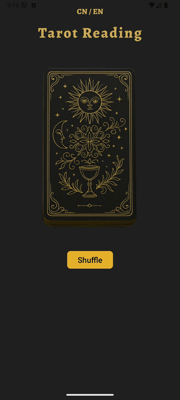
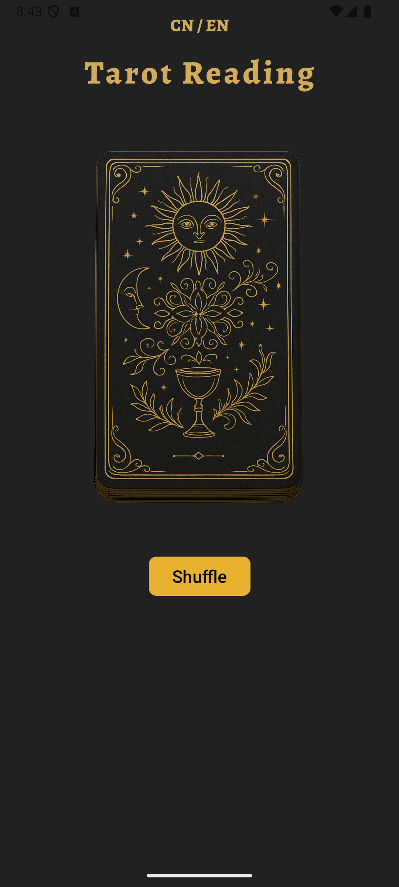
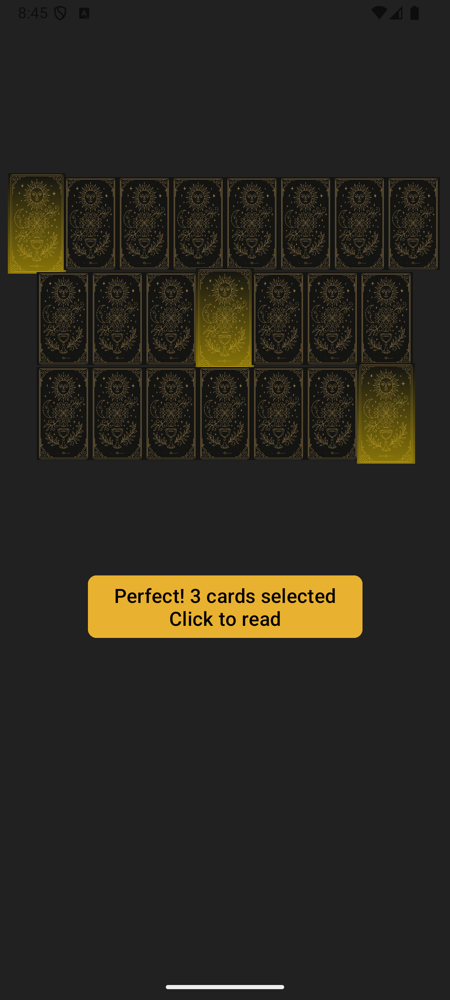
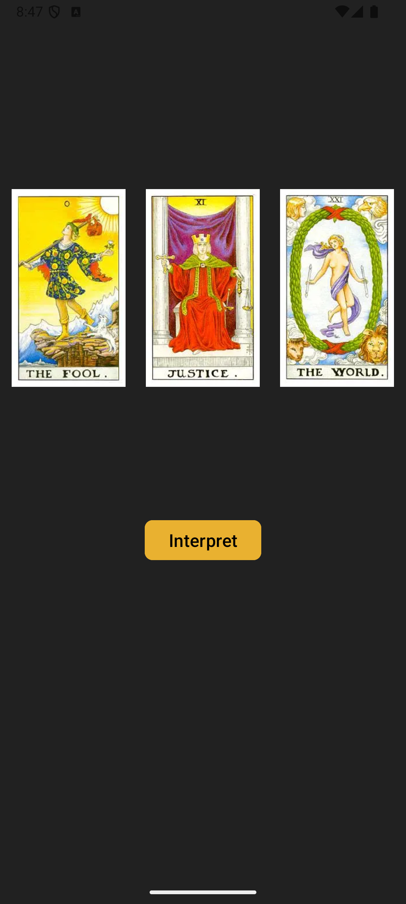
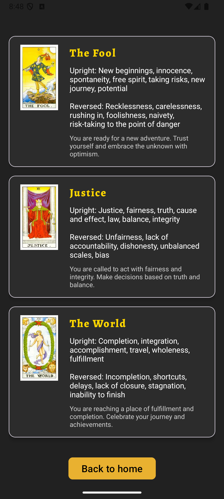

# Tarot Reading — Android App

A native Android app that turns a three-card tarot reading into a visual, interactive journey: shuffle the deck, choose three cards, reveal them, and explore their meanings.

Developed by **Chanjuan Li** as an Android programming course project at the **University of Eastern Finland** in 2025. This repository presents the source code and the running application.

## Shuffle animation



[Watch the full-resolution recording (1080 × 2400)](docs/images/shuffle-demo.mp4).

The shuffle is a custom animation captured from the running app. In [ShuffleFragment](app/src/main/java/com/example/finalproject_tarrotcardreading/ShuffleFragment.java), `ObjectAnimator` and `AnimatorSet` coordinate 15 card views across three spiral movement phases and a final gathering phase. When the animation finishes, the app removes those animation views and displays the 22-card selection layout.

## Screenshots

| Welcome | Choose three cards | Reveal | Read the meanings |
| --- | --- | --- | --- |
|  |  |  |  |

Screenshots captured from the app running on an Android API 35 emulator.

## Features

- A deck of **22 Major Arcana cards** with locally stored illustrations and text.
- A custom shuffle animation using translation, rotation, scaling, and fading.
- Three-card selection with glow feedback and selection progress.
- Sequential card-flip animations before the reading.
- Card names, upright meanings, reversed meanings, and descriptions.
- **English and Simplified Chinese**, with the chosen language remembered between launches.
- Offline operation; no account, API key, or backend is required.

## Try the app

1. Open the project folder in Android Studio and let Gradle sync.
2. Select the `app` run configuration.
3. Run it on an emulator or Android device running **Android 8.0 / API 26 or newer**.
4. Tap **Shuffle**, select three cards, continue to the reveal, then tap **Interpret**.
5. Use **CN / EN** on the welcome screen to switch languages.

### Build setup

| Item | Configuration |
| --- | --- |
| Language / UI | Java / XML Views |
| Gradle wrapper | 8.10.2 |
| Android Gradle Plugin | 8.8.2 |
| Gradle JDK | JDK 17 or a compatible Android Studio embedded JDK |
| Compile / target SDK | 34 / 34 |
| Minimum SDK | 26 |

Install Android SDK Platform 34 through Android Studio's SDK Manager if prompted. Android Studio creates the machine-specific `local.properties` file; it is excluded from version control.

The active app-module build script is **`app/build.gradle`**. The repository also retains an older `app/build.gradle.kts` from development; the setup above describes the active Groovy script.

After SDK configuration, the command-line debug build is:

```bash
# macOS / Linux
./gradlew assembleDebug

# Windows
gradlew.bat assembleDebug
```

## How it is organized

| Component | Responsibility |
| --- | --- |
| `MainActivity` | Hosts the app and applies the saved locale. |
| `MainFragment` | Welcome screen, language switch, and entry to the reading flow. |
| `ShuffleFragment` | Shuffle animation, card spread, and three-card selection. |
| `ThreeCardsFragment` | Reveals the selected cards with sequential flip animations. |
| `ReadingFragment` | Displays the selected cards and their meanings. |
| `Card` / `CardData` | Parcelable card model and local Major Arcana data. |
| `LocaleHelper` | Persists and applies the language preference. |

Navigation uses AndroidX Fragments and the Navigation component. Card objects travel between screens through a `Bundle` using `Parcelable`. Localized text is stored in Android string resources; the language setting uses `SharedPreferences`.

## Project scope

This is a course project focused on Android UI, animation, localization, and navigation. It currently supports one three-card flow using the Major Arcana. Saving previous readings and additional spreads are possible future extensions.

The implemented card data comes from `CardData` and Android resources. There is no Room-backed reading history in this version.

## Development documents

- [Class overview](documentation/javadoc/index.html) — a manually written HTML reference from the course submission.
- [Class diagram source](TarotAppClassDiagram_EN.puml) — PlantUML diagram.
- [Original project proposal](documentation/Simple%20Tarot%20Card%20Reader%20App.pdf).
- [Original course report](documentation/Project%20document_chanjuanli.pdf).

The PDFs are preserved as historical course documents. Their descriptions of planned data storage and navigation may differ from the final code; the implementation and setup described above reflect the current source.

Portfolio: [chanjuanli.com](https://chanjuanli.com/)
